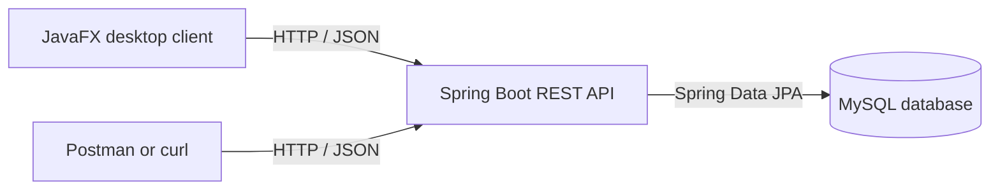

# Hostis — Employee Management System

A university project exploring employee record management through a **Java Spring Boot REST API**, **MySQL database**, and a separate **JavaFX desktop client**. The backend can be started locally using **Docker Compose**.

## Project overview

Hostis provides operations for managing employees and related reference records. The repository is organized as a multi-module Maven project, separating data models and repositories, the REST backend, and the desktop interface.

### Features present in the source

- Employee create, read, update, list, and delete operations.
- REST endpoints for **employees, departments, jobs, managers, genders, and statuses**.
- MySQL persistence using Spring Data JPA / Hibernate.
- JavaFX/FXML views and controllers for creating, editing, listing, and deleting employees.
- Docker Compose configuration for the database and Spring Boot API.
- JSON responses that can be inspected with tools such as Postman.

## Tech stack

| Area | Technologies |
| --- | --- |
| Language | Java 17 |
| REST backend | Spring Boot, Spring Web |
| Persistence | Spring Data JPA, Hibernate, MySQL 8 |
| Desktop UI | JavaFX, FXML |
| Build | Maven (multi-module project) |
| Local deployment | Docker, Docker Compose |
| API testing | Postman or curl |

## Architecture



The JavaFX client and the backend are **different applications**. The Docker Compose setup starts the **backend and MySQL database**; it does not launch the desktop interface.

## Repository structure

```text
Hostis-Employee-Management/
├── README.md
├── .gitignore
├── .dockerignore
├── .env.example
├── pom.xml                     # Maven parent project
├── docker-compose.yml
├── empldata/                   # Shared entities, models, repositories, services
├── sbemplms/                   # Spring Boot REST API, Dockerfile, application config
└── emplms/                     # JavaFX desktop application and FXML views
```

## Run the backend locally

### Prerequisites

- [Docker Desktop](https://www.docker.com/products/docker-desktop/) with Docker Compose, or an equivalent Docker setup.
- Port **8080** available for the API; port **3306** available for the database.
- If developing without Docker: **Java 17**, **Maven**, and a compatible MySQL installation.

### Docker Compose instructions

From the repository root (the directory containing `docker-compose.yml`):

1. Create a local environment file by copying `.env.example` to `.env`.
2. Open `.env` and set your own local database passwords. **Never commit `.env`.**
3. Build and start the backend and MySQL containers:

   ```bash
   docker compose up --build
   ```

4. In a second terminal, check the employee endpoint:

   ```bash
   curl http://localhost:8080/api/employee
   ```

5. Stop the containers when finished:

   ```bash
   docker compose down
   ```

An empty `[]` response is expected if the table exists but no employee records have been inserted. If the API is unavailable, check the container logs and port conflicts:

```bash
docker compose logs -f app
docker compose logs -f db
```

> **Note:** These are instructions based on the uploaded source and project documentation. This public-source copy has not been rebuilt or executed in a Docker environment here, so additional troubleshooting may be required.

## API endpoints

The controller code defines the following resource paths:

| Resource | Collection endpoint |
| --- | --- |
| Employees | `/api/employee` |
| Departments | `/api/department` |
| Jobs | `/api/job` |
| Managers | `/api/manager` |
| Genders | `/api/gender` |
| Statuses | `/api/status` |

For each resource, the API controllers implement:

| Operation | HTTP method | Path |
| --- | --- | --- |
| List records | `GET` | `/api/{resource}` |
| Get by ID | `GET` | `/api/{resource}/{id}` |
| Create | `PUT` | `/api/{resource}` |
| Update | `POST` | `/api/{resource}` |
| Delete | `DELETE` | `/api/{resource}/{id}` |

**Important:** The code uses `PUT` to create and `POST` to update. That differs from many conventional REST APIs; the table reflects the actual source rather than changing the implementation in the documentation.

### Example request

```bash
curl http://localhost:8080/api/employee
```

Or open `http://localhost:8080/api/employee` in a browser to inspect a read-only response.

## JavaFX desktop interface

The `emplms/` module contains a desktop UI with forms for employee creation, editing, and deletion. The JavaFX services are written to call the API at `http://localhost:8080`.

To explore the desktop client, open the **root Maven project** in IntelliJ IDEA or another Java 17-compatible IDE, ensure the backend is running, and inspect the main entry point:

```text
com.gabriel.emplms.ManageEmployeeApplication
```

The JavaFX launch setup has not been re-tested for this publication package. IDE and JavaFX runtime configuration may be needed to run it.

## Notes on implementation

- This is a **local academic prototype**, not a production HR system.
- The uploaded project does not include production authentication/authorization or production-grade secrets management. Do not expose the API directly to the public internet or store real employee personal data.
- The database is intended for local development and demonstration; no real employee dataset is included.
- This repository includes only editable source files and configuration, not generated `target/` directories or compiled JARs.
- The sanitized publication copy moves local Docker database credentials into an ignored `.env` file and corrects an obvious malformed URL separator in the six JavaFX service delete methods.
- Any bundled artwork in the desktop module should be reviewed for redistribution rights before publishing.

## Future improvements

Potential extensions include automated tests, API authentication, validation, a consistent REST method convention, API documentation (OpenAPI/Swagger), CI checks, and a demo using synthetic employee records.

## Project context

Created as a university software development project to practice **Java backend architecture**, **database persistence**, **CRUD APIs**, **desktop-to-backend integration**, and **containerized local deployment**.
